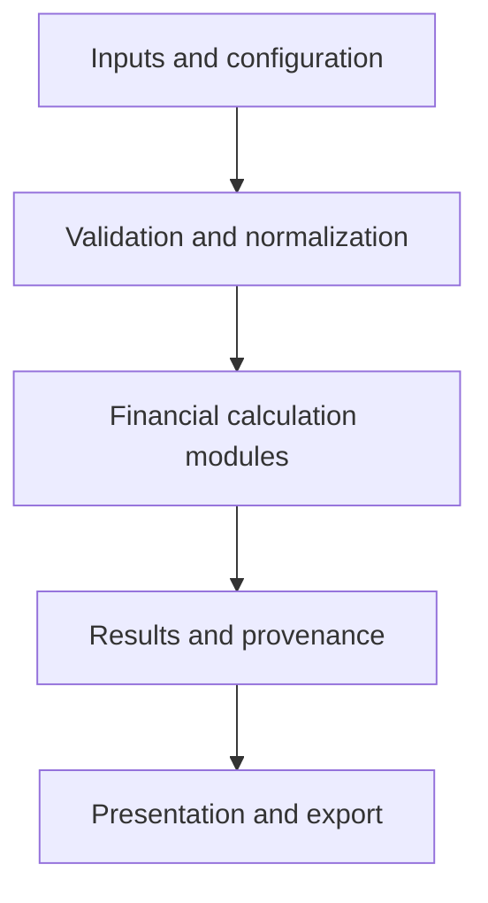

# 21.1 — Capstone Architecture

**Book:** Book 1 — Python Foundations for Financial Mathematics  
**Chapter:** 21 — Integrated Capstone: Financial Mathematics Toolkit  
**Status:** Published draft; comprehensive runtime, mathematical and editorial QA deferred until Book 1 manuscript completion.

## Learning objectives

Describe the toolkit's intended use, layers, data flow and module boundaries; define financial and software contracts; identify dependencies and cross-cutting numerical policies; and trace a simple valuation through an executable architectural slice. Distinguish the intended design from features actually implemented.

## 1. The capstone

This chapter brings Book 1 together into an educational toolkit for financial calculations and analysis. It integrates time value, cash flows, loans, bonds, returns, portfolios, statistics, simulation, data validation and visualization. Later sections specify and build these components incrementally; this opening section defines their boundaries and provides a small valuation slice.

The toolkit is a learning system, not a certified financial product. Intended use, instruments, assumptions, tolerances, data rights, security, operational controls and independent review must be established before any real-world use. A passing example is not evidence that a model or a complete application is suitable for a decision.

## 2. Architecture at a glance



An application or notebook supplies inputs and configuration. Validation establishes type, finiteness, units, timing and permitted ranges; calculations operate on validated values. Results carry enough context to interpret the number. Presentation formats results or creates plots without changing the mathematical meaning. Tests, numerical policy, documentation, logging and reproducibility apply across these boundaries.

The diagram shows a logical dependency direction, not a deployment diagram. There is no live market feed, service, database, persistent evidence store or plotting implementation in this section.

## 3. Proposed module responsibilities

| Component | Responsibility | Boundary and example assumptions |
|---|---|---|
| Configuration and contracts | Specify supported use, conventions, limits and versions | Explicit settings; no hidden market or environment defaults |
| Validation | Check shape, type, domain, units and missingness; normalize only under a documented policy | Invalid values cause a clear error; no silent imputation |
| Time value and cash flows | Discount or compound, compute periodic NPV | Timing and effective rate period must match |
| Loans | Payment and balance calculations | State payment timing, rate, fees and rounding |
| Bonds | Cash-flow valuation and sensitivity | State dates, yield/curve and price conventions |
| Returns and performance | Compute and aggregate returns | Define price adjustments, cash flows and periods |
| Portfolio | Combine exposures, returns and risk inputs | Align asset identifiers, weights and covariance units |
| Statistics | Summaries and estimators | Specify observations, missingness and degrees of freedom |
| Simulation | Generate scenarios and estimate outcomes | Record model, generator, seed, parameters and uncertainty |
| Visualization | Present results and assumptions | Label units and dates; do not silently transform data |
| Evidence and testing | Record versions, checks and findings | Actual execution evidence is distinct from test definitions |

A dependency should point toward a stable contract. For example, a bond module may call a documented cash-flow valuation function; the cash-flow module should not import the plotting layer. Keep raw data acquisition at a boundary and keep financial functions deterministic where practical. The precise APIs remain to be developed in later sections.

## 4. Example flow and financial contract

An illustrative request contains a payment of 110 currency units due one period ahead at an effective rate of 10%. The one-period model is:

```math
PV=\frac{C}{1+r},\qquad r>-1.
```

Here $`110/1.1=100`$ in exact arithmetic. A boundary validates the input and associates a caller-supplied currency label; a pure calculation returns the amount; a result object retains the inputs, convention and model identifier. A consumer can display the amount but should not infer that the model includes credit, taxes, liquidity, day-count conventions, exchange rates or uncertainty. A currency label is metadata, not an FX conversion or proof that an amount is valid for a particular currency.

At zero rate the result is 110. For a positive payment, increasing the rate decreases the one-period present value, all else equal. A payment can be negative when it is an outflow. The rate must be effective for the same period as the payment. Values are unrounded binary floats; financial rounding belongs to an explicitly specified downstream policy. The reference slice accepts only finite built-in floats and a nonblank currency label. Its computations can round, underflow or overflow; overflow is rejected. An accepted rate is not necessarily economically appropriate.

## 5. Proposed project organization

```text
financial-toolkit/
  README.md
  src/financial_toolkit/
    validation.py
    time_value.py
    cashflows.py
    loans.py
    bonds.py
    returns.py
    portfolio.py
    statistics.py
    simulation.py
    visualization.py
  tests/
  docs/
```

This is a proposed layout, not a set of files created by this section. Package metadata, versioning, dependency pinning, supported Python versions and installation tests must be specified in subsequent work. Keep independent benchmarks and actual test evidence alongside, but separate from, test source. Avoid a dependency from financial calculations to a particular UI or visualization framework.

## 6. Cross-cutting design decisions

| Concern | Architectural decision and open work |
|---|---|
| Units and timing | Make currency, rate convention, valuation date and cash-flow timing explicit where applicable; never silently mix them. |
| Numeric policy | Specify where floats or Decimal are used, precision, rounding and tolerances. Decimal does not itself define a business rounding policy. |
| Errors | Validate at boundaries, raise documented errors, and distinguish an invalid result from a valid zero. |
| Data | Track source, availability time, revisions, missingness and transformations; avoid look-ahead. |
| Reproducibility | Record source revision, inputs or secure input references, configuration, versions and random-generator details where relevant. |
| Security and privacy | Minimize sensitive data in logs and artifacts; define access, retention and dependency controls for actual use. |
| Testing | Combine known-value, boundary, property, regression, integration and installed-package checks as appropriate. |
| Model governance | Document purpose, assumptions, owner, limitations, independent challenge and unresolved findings. |

A tolerance must have a rationale and units. Test results are evidence for specified cases; they do not establish coverage of every input or model suitability. Do not confuse a formatted number with a validated result.

## 7. Reference architectural slice

Save the following as `capstone_architecture.py`. It implements only one-period present value and a small orchestration boundary. It does not implement the proposed modules above or persist provenance. Python 3.10 or newer is required for the annotations.

```python
from dataclasses import dataclass
import math


@dataclass(frozen=True)
class ValuationRequest:
    payment: float
    rate: float
    currency: str


@dataclass(frozen=True)
class ValuationResult:
    amount: float
    currency: str
    payment: float
    rate: float
    convention: str
    model: str


def validate_request(request: ValuationRequest) -> None:
    """Check this slice's narrow, explicit input contract."""
    if not isinstance(request, ValuationRequest):
        raise ValueError("request must be a ValuationRequest")
    if type(request.payment) is not float or not math.isfinite(request.payment):
        raise ValueError("payment must be a finite float")
    if (type(request.rate) is not float or not math.isfinite(request.rate)
            or request.rate <= -1.0):
        raise ValueError("rate must be a finite float greater than -1")
    if type(request.currency) is not str or not request.currency.strip():
        raise ValueError("currency must be a nonblank string")


def present_value_one_period(payment: float, rate: float) -> float:
    """Discount one finite float payment by one effective period.

    The rate must exceed -1. Return an unrounded float; reject a nonfinite
    result. Floating-point rounding and underflow remain possible.
    """
    # This public calculation also validates its inputs when used directly.
    if type(payment) is not float or not math.isfinite(payment):
        raise ValueError("payment must be a finite float")
    if type(rate) is not float or not math.isfinite(rate) or rate <= -1.0:
        raise ValueError("rate must be a finite float greater than -1")
    value = payment / (1.0 + rate)
    if not math.isfinite(value):
        raise ValueError("nonfinite present value")
    return value


def evaluate(request: ValuationRequest) -> ValuationResult:
    """Validate, calculate and attach interpretation metadata."""
    validate_request(request)
    amount = present_value_one_period(request.payment, request.rate)
    return ValuationResult(amount, request.currency, request.payment,
                           request.rate, "one effective period", "pv-one-v1")


if __name__ == "__main__":
    result = evaluate(ValuationRequest(110.0, 0.10, "USD"))
    print(f"PV: {result.amount:.2f} {result.currency}; model={result.model}")
```

The output is expected to display `PV: 100.00 USD; model=pv-one-v1`. The two-decimal display is illustrative, not a currency rounding policy. `frozen=True` prevents normal field reassignment; it does not create a durable audit record. The label is preserved exactly as supplied; the slice neither validates ISO codes nor converts currencies. In a larger package, a shared validator could avoid duplicated checks while preserving safe public boundaries.

## 8. Twelve Python reference tests

Save the following as `test_capstone_architecture.py` beside the reference slice. These are test definitions, not evidence of an executed run. The tolerances are illustrative in payment units.

```python
import math
import unittest
from dataclasses import FrozenInstanceError
from capstone_architecture import (ValuationRequest, evaluate,
                                  present_value_one_period)


class ArchitectureTests(unittest.TestCase):
    def test_known_value(self):
        self.assertTrue(math.isclose(evaluate(ValuationRequest(110.0, 0.1, "USD")).amount,
                                     100.0, rel_tol=0.0, abs_tol=1e-10))
    def test_zero_rate(self):
        self.assertEqual(present_value_one_period(110.0, 0.0), 110.0)
    def test_negative_rate(self):
        self.assertTrue(math.isclose(present_value_one_period(95.0, -0.05), 100.0,
                                     rel_tol=0.0, abs_tol=1e-10))
    def test_negative_payment(self):
        self.assertTrue(math.isclose(present_value_one_period(-110.0, 0.1), -100.0,
                                     rel_tol=0.0, abs_tol=1e-10))
    def test_rate_monotonicity(self):
        self.assertGreater(present_value_one_period(100.0, 0.05),
                           present_value_one_period(100.0, 0.10))
    def test_rate_boundary(self):
        with self.assertRaises(ValueError):
            evaluate(ValuationRequest(100.0, -1.0, "USD"))
    def test_nonfinite_payment(self):
        with self.assertRaises(ValueError):
            evaluate(ValuationRequest(float("nan"), 0.1, "USD"))
    def test_nonfinite_rate(self):
        with self.assertRaises(ValueError):
            evaluate(ValuationRequest(100.0, float("inf"), "USD"))
    def test_boolean_rejected(self):
        with self.assertRaises(ValueError):
            evaluate(ValuationRequest(100.0, True, "USD"))
    def test_blank_currency(self):
        with self.assertRaises(ValueError):
            evaluate(ValuationRequest(100.0, 0.1, "  "))
    def test_metadata(self):
        result = evaluate(ValuationRequest(110.0, 0.1, "USD"))
        self.assertEqual((result.currency, result.payment, result.rate,
                          result.convention, result.model),
                         ("USD", 110.0, 0.1, "one effective period", "pv-one-v1"))
    def test_result_is_frozen(self):
        result = evaluate(ValuationRequest(110.0, 0.1, "USD"))
        with self.assertRaises(FrozenInstanceError):
            result.amount = 0.0


if __name__ == "__main__":
    unittest.main(verbosity=2)
```

During deferred QA, from the directory containing both files:

```bash
python capstone_architecture.py
python -m unittest -v test_capstone_architecture
python -m compileall -q capstone_architecture.py test_capstone_architecture.py
```

Record the actual commands and output, source revision, Python version and platform. The 12 reference tests have not been run for this draft. Tests of the complete toolkit, installed artifacts and model suitability remain future work.

## 9. Twelve-step hands-on lab

1. Identify an intended educational use and a decision the toolkit is not yet suitable to support.
2. Sketch the input, validation, calculation, result and presentation boundaries.
3. Describe the payment's unit, sign, timing and rate convention for the 110 example.
4. Derive the 100 benchmark independently.
5. Save both reference files in an isolated directory.
6. Trace the request from validation to result metadata.
7. Identify which inputs are rejected and which accepted inputs could still be financially unsuitable.
8. Explain how a currency label differs from currency conversion.
9. Compare rate sensitivities for a positive and a negative payment.
10. Identify missing model assumptions, numerical policies and evidence needed for actual use.
11. During deferred QA, run the commands above and retain actual environment and results.
12. Propose an integration test and an independent model review for a future module; assign a finding and owner.

## 10. Forty worked exercises

1. **Purpose:** What is the capstone? **Answer:** An educational integrated financial mathematics toolkit built incrementally.
2. **Status:** Are all listed modules implemented here? **Answer:** No; only the one-period architectural slice is provided.
3. **Layers:** What precedes calculation? **Answer:** Validation and any documented normalization.
4. **Presentation:** Should a plotting layer define financial formulas? **Answer:** No; use calculation results and clearly label transformations.
5. **Dependency:** May a bond module use a cash-flow function? **Answer:** Yes, through a documented contract.
6. **Direction:** Should cash-flow valuation require a plotting package? **Answer:** No; keep presentation outside the calculation core.
7. **Known value:** PV of 110 in one period at 10%? **Answer:** 100 in exact arithmetic.
8. **Zero rate:** PV of 110 at zero? **Answer:** 110.
9. **Negative rate:** PV of 95 at −5%? **Answer:** 100 in exact arithmetic.
10. **Boundary:** Why reject rate −1? **Answer:** Its denominator is zero.
11. **Rate units:** Is 10.0 equivalent to 10%? **Answer:** No; 10% is 0.10.
12. **Period:** Can an annual rate be applied unconverted to a monthly payment? **Answer:** Not under this contract; periods must match.
13. **Signs:** Can a payment be negative? **Answer:** Yes; document the perspective.
14. **Currency:** Does `USD` convert the amount? **Answer:** No; it is a label only.
15. **Code:** Does the example verify ISO currency codes? **Answer:** No; it checks only a nonblank string.
16. **Rounding:** Is the internal result rounded to cents? **Answer:** No; display formatting is separate.
17. **Overflow:** Can finite inputs create infinity? **Answer:** Yes; the slice rejects a nonfinite result.
18. **Underflow:** Does a finite result guarantee accuracy? **Answer:** No; underflow and rounding can occur.
19. **Type:** Is an integer payment accepted by the slice? **Answer:** No; it requires a built-in float.
20. **Boolean:** Is `True` a valid rate? **Answer:** No, despite Boolean being an integer subtype in Python.
21. **Result:** Why keep the rate alongside the amount? **Answer:** To make the result interpretable and support traceability.
22. **Provenance:** Does an in-memory result constitute an audit trail? **Answer:** No; durable, controlled evidence needs additional design.
23. **Immutability:** What does a frozen dataclass prevent? **Answer:** Normal reassignment of its fields.
24. **Error:** Why raise an exception for invalid input? **Answer:** To distinguish failure from a valid numerical result.
25. **Tolerance:** Why give a tolerance units? **Answer:** An amount tolerance differs from a rate tolerance.
26. **Benchmark:** Why independently derive 110/1.1? **Answer:** To reduce the risk of reproducing a code defect in the expected value.
27. **Monotonicity:** Does positive-payment PV fall as the rate rises? **Answer:** Yes, for this one-period model above −1.
28. **Mixed signs:** Must a mixed-sign cash-flow NPV always fall as rate rises? **Answer:** No.
29. **Model scope:** Does the slice model default? **Answer:** No.
30. **Suitability:** Does passing a software test prove the model fits a risky instrument? **Answer:** No; assumptions require independent review.
31. **Data:** Why record availability time? **Answer:** To avoid using information before it was available.
32. **Simulation:** Is the seed alone always sufficient for reproduction? **Answer:** No; record generator, version, environment and configuration too.
33. **Portfolio:** Why align identifiers and weights? **Answer:** Misalignment can associate exposures with the wrong assets.
34. **Statistics:** Why specify degrees of freedom? **Answer:** It affects estimators such as sample variance.
35. **Logging:** Should sensitive cash flows be logged by default? **Answer:** No; minimize and protect sensitive information.
36. **Integration:** What should an integration test exercise? **Answer:** The interaction of components across their documented boundaries.
37. **Installation:** Does running from a source folder verify an installed package? **Answer:** No.
38. **Release:** Is this slice production certified? **Answer:** No; it is a draft educational example.
39. **Evidence:** What belongs in a test record? **Answer:** Revision, commands, versions, environment and actual results.
40. **Next:** What follows architecture in the locked TOC? **Answer:** 21.2 — Requirements and Assumptions.

## 11. Troubleshooting

| Symptom | Possible cause | Next step |
|---|---|---|
| `ModuleNotFoundError` | Files are not in the same working directory | Check filenames and run from that directory |
| `ValueError` | Invalid input type, rate, finiteness or label | Inspect the contract and sanitized input |
| Small numerical discrepancy | Binary floating-point rounding | Reconcile assumptions and choose a justified tolerance |
| Result is reproducible but unsuitable | Model assumptions do not match the use | Perform independent model review |
| A module is missing | The layout is proposed, not fully implemented | Continue with the subsequent capstone sections |

## References for later source review

- [Python documentation: dataclasses](https://docs.python.org/3/library/dataclasses.html)
- [Python documentation: floating-point arithmetic](https://docs.python.org/3/tutorial/floatingpoint.html)
- [Python documentation: unittest](https://docs.python.org/3/library/unittest.html)
- [Chapter 20 project](../chapter-20/20.15-chapter-project-production-quality-financial-library.md)

**Next:** 21.2 — Requirements and Assumptions.
