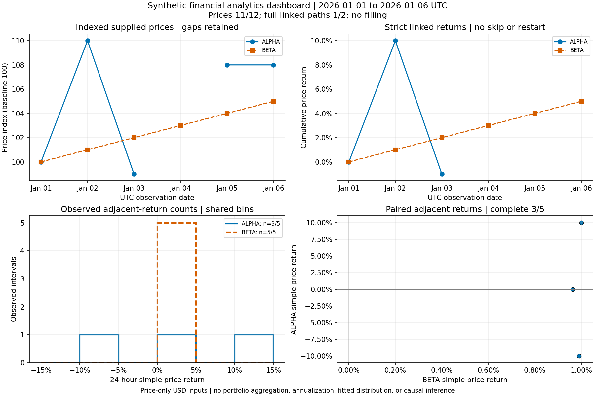

# Book 1 — Later-example validation and completed source-fence mapping

**Status:** Source-fence selection/disposition mapping complete; **V05/V06 remain IN PROGRESS**. Reviewer/owner: Codex. Recorded 2026-10-28. Source revision: `ad21fb037bae4cc40d334c493704c99232b8e7c8`. No chapter manuscript or Python payload was changed.

## Final mapping checkpoint

All **1,160 explicit manuscript Python fences** now have an execution-selection mapping or an explicit non-runtime disposition. The [current ledger](current-coverage-ledger.json) has **zero fences in the no-exact-execution-mapping queue**.

| State | Fences | Meaning |
|---|---:|---|
| Unchanged historical execution selections | 543 | Previously recorded selection, with payload continuity to the evidence publication source |
| First supplemental batch | 16 | Source fences in 13 passing workflows |
| Chapters 1–3 supplemental runtime selections | 405 | Source fences in 98 passing workflows |
| Later supplemental runtime selections | 169 | Source fences in this batch's 81 passing workflows |
| Placeholder statements / Ellipsis bodies | 23 | Explicitly not run as financial algorithms |
| Loop-context fragments | 2 | Require an enclosing loop; standalone runtime not claimed |
| Warned-against input-evaluation pattern | 1 | Explicitly not executed |
| Deliberately invalid typing example | 1 | Expected static diagnostics verified; ordinary runtime not claimed |
| Total | 1,160 | Exhaustive recorded manuscript-fence inventory |

Thus **1,133 fences have source-selection mappings**, while 27 have explicit other dispositions. This is not 1,133 fully exercised programs: imports/definitions can execute without their bodies or main guards, some assemblies overwrite names, and no line/branch coverage percentage is established. Fixtures, examples and support modules are different units. The three supplemental batches comprise **192 workflow cases** (13 + 98 + 81), plus two separately recorded static-checker cases. The earlier **2,996 reference-test-method total is unchanged**; existing methods are not counted again.

The full history remains in the [initial coverage report](../coverage-and-labs-2026-10-28/README.md) and [Chapters 1–3 report](../early-examples-2026-10-28/README.md), including the initial harness failures and corrections. See the [chapter mapping table](CHAPTER-MAPPING.md) and [169 new dispositions](later-dispositions.json).

## Actual later workflow results

All 81 workflows passed on CPython 3.12.14 / Linux x86_64 with glibc 2.39. Every subprocess exited zero with empty stderr and the configured checks passed. FutureWarning was treated as an error. [Environment](environment.json), [plans and oracles](later_plan.py), [structured results](workflow-results.json) and [combined output](runtime-output.log) are retained.

| Chapter | New workflow cases | Previously unmapped source fences | Scope checked |
|---|---:|---:|---|
| 4 | 14 | 49 | Lists, tuples, dictionaries, sets, sorting, nested records, schedules, copying and exercise fixtures |
| 5 | 3 | 4 | Main-guard import/execution with a controlled entry-point double; Decimal/date/JSON/file-lifetime examples |
| 7 | 16 | 40 | Alignment, missingness, indexing, types, dates, grouping, joins, resampling, rolling, returns and panel function |
| 8 | 10 | 21 | Headless plotting, labels/data/artist properties, PNG/SVG exports, date formatting, gaps and digest verification |
| 11 | 1 | 2 | Float comparison and half-up Decimal rounding outputs |
| 13 | 4 | 5 | Small-return logarithms, geometric-mean API examples and return fixture |
| 14 | 3 | 3 | Sampling, seeded draw order and the full 20,000-draw/500-bootstrap experiment driver |
| 15 | 1 | 1 | Exact CSV-loader/report usage with the manuscript fixture |
| 16 | 1 | 1 | Two-asset covariance input fixture checked against a rational sample-covariance benchmark |
| 17 | 11 | 15 | SciPy root finding, IRR, optimization, quadrature, interpolation, calibration and numerical-stability snippets |
| 18 | 7 | 9 | Standard-library/NumPy draws, state replay, child-stream keys and the 100,000-payoff batching example |
| 21 | 10 | 19 | Separate package stages 21.5–21.14: exact stage-specific exports, module support and example-use blocks |

Supporting implementations and declared fixtures are copied exactly from the manuscript. Constants, labels, timestamps and callback doubles are explicit in the plans; they are not silently inferred during execution. The capstone initializer from each stage is imported in a fresh workspace, rather than repeatedly overwriting it and crediting only the final initializer. These are source-tree import/example checks, not installed-distribution acceptance.

Sixteen of the 81 cases exercise pandas examples with controlled data. Numeric checks include the two-period IRR's quadratic root, constrained weights `[.4, .6]`, the discount-factor benchmark `127/140`, polynomial/discounted-flow integration and a sample covariance matrix with entries `1/6000`, `1/5000`, `1/3000`. These are bounded checks, not independent approval of all financial formulas, assumptions or tolerances. Random/simulation checks establish the recorded run's elementary invariants and replay behavior; they do not prove distribution quality, independence, stream non-overlap or statistical suitability.

Two workflows deliberately expect exceptions: top-level main-guard execution raises `SystemExit(0)` through a controlled entry point; an altered dashboard output raises the specified digest-mismatch `ValueError`. Both are expected passing outcomes. The untampered dashboard digest check passes first; the tampered check uses a separate output workspace and appends controlled bytes only to its synthetic PNG. No manuscript correction or new implementation failure was found in this later batch.

## Retained rendering and integrity evidence

The full Section 8.13 dashboard was regenerated from its synthetic CSV. Its code, input and six output hashes were checked against its actual evidence file. The report preserves **11/12 price observations**, **3/5 complete paired-return intervals** and **1/2 complete linked paths**, without filling missing prices. [Input, tables, PNG/SVG and metadata](artifacts/dashboard/evidence.json) are retained with the [artifact manifest](artifact-manifest.json).



The 1800×1200 dashboard was visually inspected: panel titles, units, UTC dates, legends, observed counts, the missing ALPHA price gap and the stopped strict linked path were visible. The Section 21.14 960×720 [synthetic price chart](artifacts/synthetic_price.png) was also rendered and visually inspected; its two input observations, USD label and UTC time axis were visible. This is a scoped inspection of two renderings, not a full accessibility/visual acceptance review. Other plotting snippets received structural/export checks only. Rendering hashes identify these exact files; fonts, metadata and versions can change bytes on another host even when the intended chart is equivalent.

## Reproduction and integrity

Create an isolated Python 3.12 environment using [requirements.txt](requirements.txt). From this evidence directory, choose new output directories:

```bash
python run_later_examples.py ../.. /tmp/book1-later-reproduction
python reconcile_later_coverage.py ../.. /tmp/book1-later-ledger-reproduction /tmp/book1-later-reproduction/results.json ad21fb037bae4cc40d334c493704c99232b8e7c8
```

The runner validates fixture/oracle syntax and target indices before launching examples, uses fresh workspaces, removes inherited Python path overrides, sets Agg and applies a 120-second subprocess timeout. It executes original payloads with declared support/fixtures and records actual commands, source hashes, cases and output. The 120-second cap accommodates the unchanged probability/bootstrap driver; it is not a performance target. Negative cases check actual exception types and stated conditions.

The reconciler requires the previous ledger's 169 unresolved identities to match the new workflow source identities exactly, verifies every current manuscript-fence payload hash, and asserts that all 1,160 identities remain present with zero unclassified mappings. [Source-manifest hashes](source-manifest.json) cover all 356 chapter/companion/index Markdown documents. The environment/profile record describes this Linux/Python run; no Windows, macOS, notebook, installed-wheel or alternative-version result is implied.

## Next validation work

Continue **V06 lab-step and worked-answer review**, using the separate 449-heading candidate queue in the initial coverage evidence. Prioritize exact instructions, prerequisites, expected outputs and independently derived answers for each complete lab/project. Maintain the distinction between this completed source-selection inventory and the still-open V05 branch/input/platform scope, V07 mathematical/financial review, V08 numerical range/tolerance review, V10 statistical review and V12 installed/platform checks. No Book 1 canonical, model or production certification is implied.
